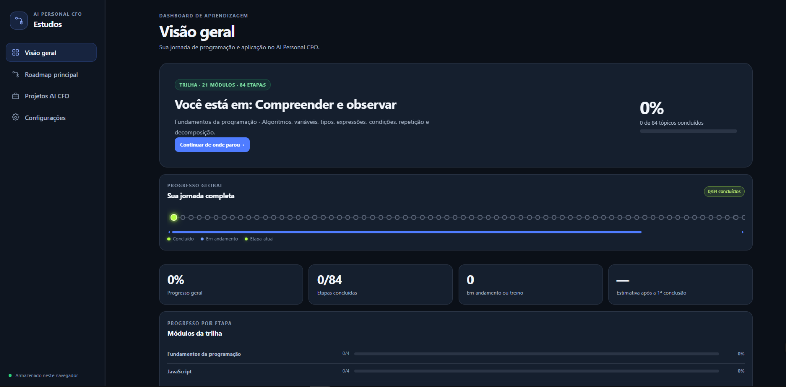
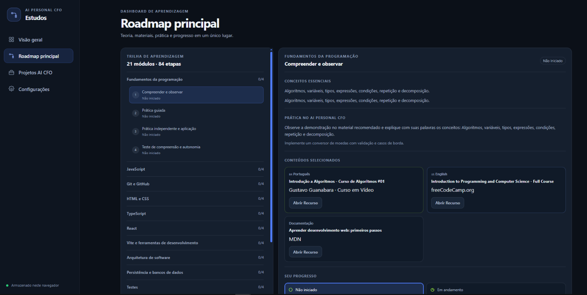
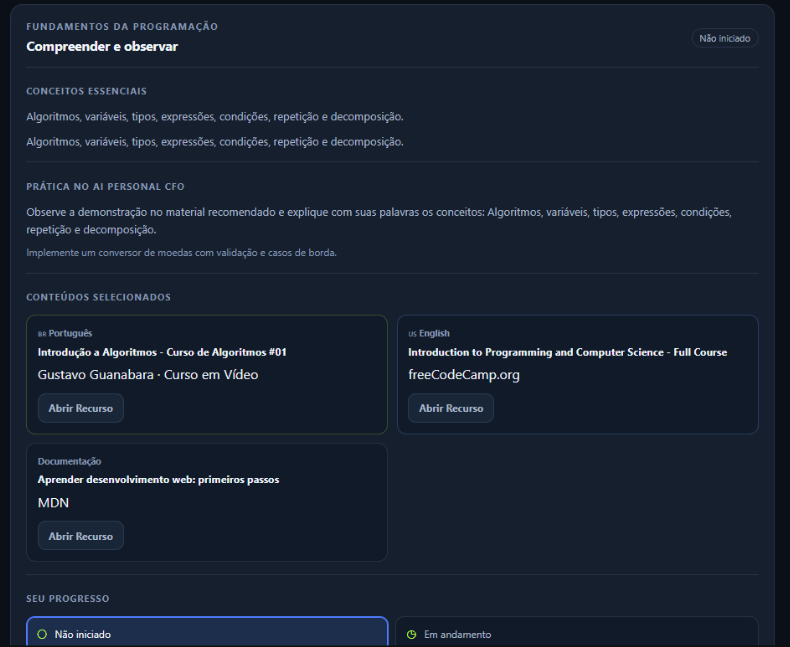
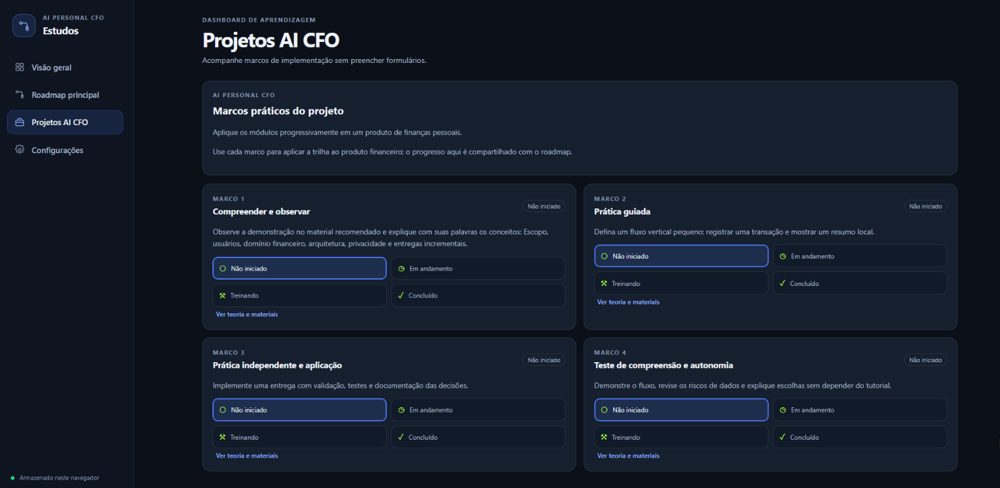
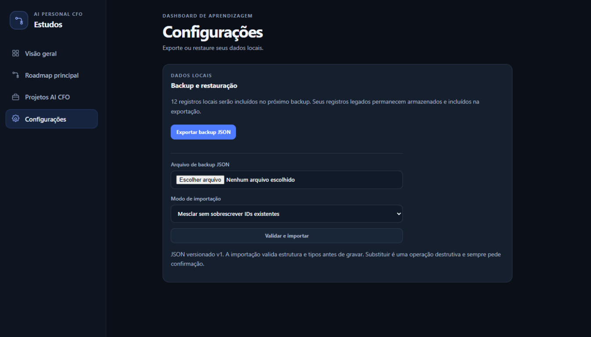

# Dashboard de Estudos - AI Personal CFO

**Acesse:** <https://marianavagostini-byte.github.io/dashboard-estudos-ai-cfo/>


Aplicação local para organizar uma trilha prática de programação e acompanhar sua aplicação na construção de um **AI Personal CFO** (assistente financeiro pessoal).

## Estado atual do catálogo

O Roadmap ativo é hierárquico: 11 fases, 62 matérias e 165 tópicos, incluindo **20 matérias do roadmap principal** e **DSA + LeetCode em trilha paralela** (15 tópicos). O catálogo está em `src/studyCatalog.ts`; os status ficam separados nos registros do IndexedDB e nenhum progresso antigo é migrado automaticamente. Consulte [`docs/dsa-topic-proposal.md`](./docs/dsa-topic-proposal.md) para distinguir os seis tópicos DSA recuperados dos nove propostos.

A interface permite buscar e filtrar por matéria, fase e status, expandir/recolher a hierarquia, editar o status em três estados e abrir detalhes sob demanda, com data de conclusão e histórico quando houver registros reais. O intercâmbio com ChatGPT usa JSON v2 e importação manual com validação, prévia e aprovação explícita; v1 continua aceito para manter a compatibilidade dos backups e sessões legadas. Consulte [`integracao/PROTOCOLO-CHATGPT.md`](./integracao/PROTOCOLO-CHATGPT.md).

### Definição de progresso

- **Progresso principal (20 matérias)**: tópicos pertencentes às 20 áreas de `curriculumAreas`, com status `Concluído`. Total de **137 tópicos**.
- **Trilha paralela DSA**: 15 tópicos contabilizados separadamente, sem bloquear a sequência principal.
- **Tópicos fora das 20 matérias**: 13 tópicos (4 de Python, 2 de REST API prática, 2 de Projeto Full Stack e 5 de especializações futuras) permanecem no catálogo, podem ser registrados, mas não entram no percentual das 20 matérias.
- **Catálogo completo**: 137 principais + 13 suplementares + 15 DSA = **165 tópicos**. Esse é o total de itens cadastrados, não o denominador do progresso geral.
- A interface e a visão geral exibem essa composição explicitamente para evitar que 137 e 165 sejam lidos como divergência.
- **Registros legados** (`roadmapStage` sem `topicId`) são preservados, mas não entram no percentual principal. A migração continua somente leitura até haver mapeamento explícito, prévia, backup e aprovação.
- O status `Disponível` ou `Bloqueado` é derivado dos pré-requisitos quando não há registro salvo; nenhum status implícito é gravado.
- O navegador do Roadmap agrupa por matéria na ordem oficial (JavaScript → AI Personal CFO); suplementares e DSA aparecem depois, identificados como fora do progresso principal e trilha paralela.


## Sobre o projeto

Aplicação local para organizar estudos de desenvolvimento de software. O Roadmap ativo é um catálogo hierárquico de fases, matérias, tópicos e subtópicos; DSA + LeetCode é uma trilha paralela. O catálogo fica em `src/studyCatalog.ts` e os registros de progresso permanecem separados no IndexedDB do navegador.

O aplicativo não executa código enviado pelo usuário nem se conecta automaticamente a serviços de IA. O intercâmbio com ChatGPT é manual por JSON v2, com validação, prévia e aprovação explícita antes de atualizar progresso.
## Demonstração visual

### Visão geral



### Roadmap interativo



### Detalhes da etapa



### Marcos do projeto AI CFO



### Configurações e backups



## Funcionalidades

- Catálogo hierárquico com 20 matérias ordenadas, matérias expansíveis e trilha paralela DSA + LeetCode.
- Painel das 20 matérias com progresso por matéria na ordem oficial, além do total principal e da composição 137 + 13 + 15 = 165.
- Busca por matéria/tópico/subtópico e filtros por fase e status; expandir e recolher tudo.
- Três estados editáveis (não iniciado, em andamento, concluído), com bloqueio de conclusão enquanto pré-requisitos estiverem pendentes.
- Detalhes sob demanda com objetivos, material externo, exercício, critério de conclusão, data e histórico de status.
- Próxima recomendação prioriza tópico em andamento e depois o primeiro disponível, excluindo DSA.
- Backup JSON v1 compatível com os registros existentes, incluindo configurações e sessões.
- Importação com prévia obrigatória, confirmação digitada (`SUBSTITUIR`) e backup de segurança baixado antes de substituir dados locais; backups vazios são bloqueados.
- Reconciliação de progresso antigo somente em modo de simulação; a migração real permanece desativada.
- Sessões ChatGPT v2 em fluxo manual, com IDs atuais, prévia, aprovação, idempotência e histórico.
- Alternância no Roadmap entre o catálogo das 20 matérias e o roteiro legado de teoria/revisão, sem perder o conteúdo antigo.
- Seção Programação / exercícios reúne marcos do projeto, exercícios definidos no catálogo e materiais por tópico.
- Interface responsiva e tema escuro.

A proposta revisável de DSA distingue os seis nomes recuperados dos nove propostos em [`docs/dsa-topic-proposal.md`](./docs/dsa-topic-proposal.md).
## Arquitetura

O frontend é uma aplicação React de página única. O catálogo da trilha é separado dos registros de progresso: o catálogo é definido no código e os estados escolhidos pelo usuário são persistidos localmente no navegador.

```text
.
├── .github/
│   ├── workflows/
│   │   ├── build.yml
│   │   └── tests.yml
│   └── copilot-instructions.md
├── .gitignore
├── LICENSE
├── docs/
│   ├── assets/
│   │   ├── overview.png
│   │   ├── roadmap.png
│   │   ├── stage-details.png
│   │   ├── project-milestones.png
│   │   └── settings.png
│   ├── cloudflare-plan.md
│   ├── continuidade-2026-10-22.md
│   └── publicacao-github-pages.md
├── integracao/
│   ├── schemas/session.schema.json
│   ├── entrada-chatgpt.exemplo.json
│   └── guias e histórico de intercâmbio
├── public/
│   ├── favicon.svg
│   └── icons.svg
├── src/
│   ├── assets/
│   ├── App.tsx
│   ├── App.css
│   ├── index.css
│   ├── learningRoadmap.ts
│   ├── main.tsx
│   ├── StudyWorkspace.tsx
│   ├── StudyCatalogWorkspace.tsx
│   ├── backupDownload.ts
│   ├── catalogProgress.ts
│   ├── progressMigration.ts
│   ├── studyCatalog.ts
│   ├── studyContext.ts
│   ├── studyData.ts
│   ├── studyDatabase.ts
│   ├── studyCurriculum.ts
│   ├── studySession.ts
│   └── studyTopicSession.ts
├── scripts/
│   ├── compare-backups.mjs
│   ├── safe-commit.mjs
│   └── validate-study-session.mjs
├── tests/
│   ├── backupComparison.test.mjs
│   ├── safeCommit.test.mjs
│   └── studyData.test.mjs
├── index.html
├── package-lock.json
├── package.json
├── README.md
├── tsconfig*.json
├── vite.config.ts
└── .oxlintrc.json
```

### Componentes e fluxo de dados

- `src/App.tsx` apresenta a visão geral com progresso principal, DSA separado, progresso por matéria na ordem oficial e composição dos totais do catálogo.
- `src/StudyCatalogWorkspace.tsx` apresenta fases, matérias expansíveis, busca, filtros por fase/status, três estados editáveis, histórico e detalhes selecionados.
- `src/studyCatalog.ts` contém o catálogo estático com IDs estáveis, as 20 áreas ordenadas (`curriculumAreas`) e a trilha paralela DSA.
- `src/catalogProgress.ts` deriva disponibilidade, busca, filtros, progresso por área/fase/matéria e a próxima recomendação sem gravar status implícitos.
- `src/studyData.ts` mantém tipos/regras e valida registros e backups v1, inclusive etapas antigas, tópicos novos e históricos de status/conclusão; também calcula a prévia de importação.
- `src/studyDatabase.ts` persiste no IndexedDB v1 e importa backups e sessões v1/v2 de forma transacional; não executa migração real do progresso legado.
- `src/progressMigration.ts` e `integracao/mapeamento-migracao-v1-v2.json` implementam a simulação somente leitura e o manifesto auditável.
- `src/studyTopicSession.ts` valida o intercâmbio v2; o contrato v1 continua legado para compatibilidade.
- `src/StudyWorkspace.tsx` integra o importador com prévia, confirmação digitada, backup de segurança, prévia/aprovação de sessão, histórico, backups e o relatório da simulação.
- `tests/` cobre regras de domínio, catálogo/20 áreas, progresso, transições de status, prévia de backup, importação idempotente, simulação e round-trip de backups.

O progresso permanece separado do catálogo no IndexedDB, banco `dashboard-estudos`, versão de esquema 1, stores `records` e `settings`. Não há migração de dados pessoais nesta versão.
## Publicação

O site é publicado como aplicação estática no GitHub Pages pelo workflow `.github/workflows/deploy-pages.yml`. Como o GitHub Pages em repositório privado exige plano pago, o job de deploy só roda quando o repositório é público; até lá o CI continua validando lint, testes e build. O passo a passo, a URL e o cuidado com a origem do IndexedDB estão em [`docs/publicacao-github-pages.md`](./docs/publicacao-github-pages.md).

## Requisitos

- Node.js **20.19 ou superior** ou **22.12 ou superior**.
- npm (incluído com Node.js).
- Navegador moderno com suporte a IndexedDB.

## Instalação e execução local

Na raiz do projeto:

```bash
npm install
npm run dev
```

Abra o endereço local informado pelo Vite (normalmente `http://localhost:5173/`).

### Testes, lint e build

```bash
npm test
npm run lint
npm run build
```

Para validar um JSON de sessão sem gravar dados, use `npm run session:validate -- integracao/entrada-chatgpt.json`.

Para servir localmente a build de produção:

```bash
npm run preview
```

Os workflows do GitHub Actions executam os testes e verificam build e lint em pushes e pull requests.

## Privacidade e limitações

- O conteúdo e o progresso permanecem no IndexedDB do navegador; o aplicativo não envia esses dados a um servidor.
- Não há conta, autenticação, backend ou sincronização automática com ChatGPT; a troca é manual por arquivo JSON validado.
- Não há conexão com contas financeiras reais, credenciais reais ou cobranças. O AI Personal CFO é uma trilha de construção com dados fictícios.
- Os links de vídeo e documentação são externos; a disponibilidade depende de cada provedor.
- A estimativa de término é aproximada e depende das datas de conclusão registradas.
- O progresso é uma autoavaliação; o dashboard não valida conhecimento nem executa os desafios.

## Integração com ChatGPT e Copilot Agent Mode

O Dashboard-Estudos é a fonte oficial do progresso, mantido no IndexedDB do navegador. A exportação v1 é o backup completo e restaurável. O resumo de intercâmbio é gerado localmente pela própria interface (Configurações) e não é versionado, porque contém o estado pessoal de estudos. O resumo não altera nem substitui o IndexedDB e não é um arquivo de restauração.

O fluxo de sessão ChatGPT↔Copilot é manual por JSON: salve a sessão em `integracao/entrada-chatgpt.json` (ignorado pelo Git), acione o Copilot Agent para validar e trabalhar nos artefatos reais, revise o JSON final e importe-o em **Configurações** no Dashboard. O histórico da sessão e as alterações de roadmap confirmadas são gravados pelo próprio dashboard; nenhum agente acessa diretamente o IndexedDB. Push exige pedido explícito na conversa atual, e não há execução agendada. O resumo de continuidade pode ser baixado em Configurações e precisa ser compartilhado manualmente com a próxima conversa. Consulte [`integracao/COMO-USAR.md`](./integracao/COMO-USAR.md), o [`protocolo de intercâmbio`](./integracao/PROTOCOLO-CHATGPT.md) e [`.github/copilot-instructions.md`](./.github/copilot-instructions.md).

## Continuidade e nuvem futura

O relatório da auditoria local, incluindo os limites da recuperação e os testes observados, está em [`docs/continuidade-2026-10-22.md`](./docs/continuidade-2026-10-22.md). A proposta segura para localizar, validar e recuperar o histórico — sem importar dados incompatíveis — está em [`docs/recuperacao-historico.md`](./docs/recuperacao-historico.md). A proposta futura para Pages, Access, Worker e D1, ainda sem recursos criados ou dados migrados, está em [`docs/cloudflare-plan.md`](./docs/cloudflare-plan.md).

## Licença

Este projeto está disponível sob a licença [MIT](./LICENSE).
